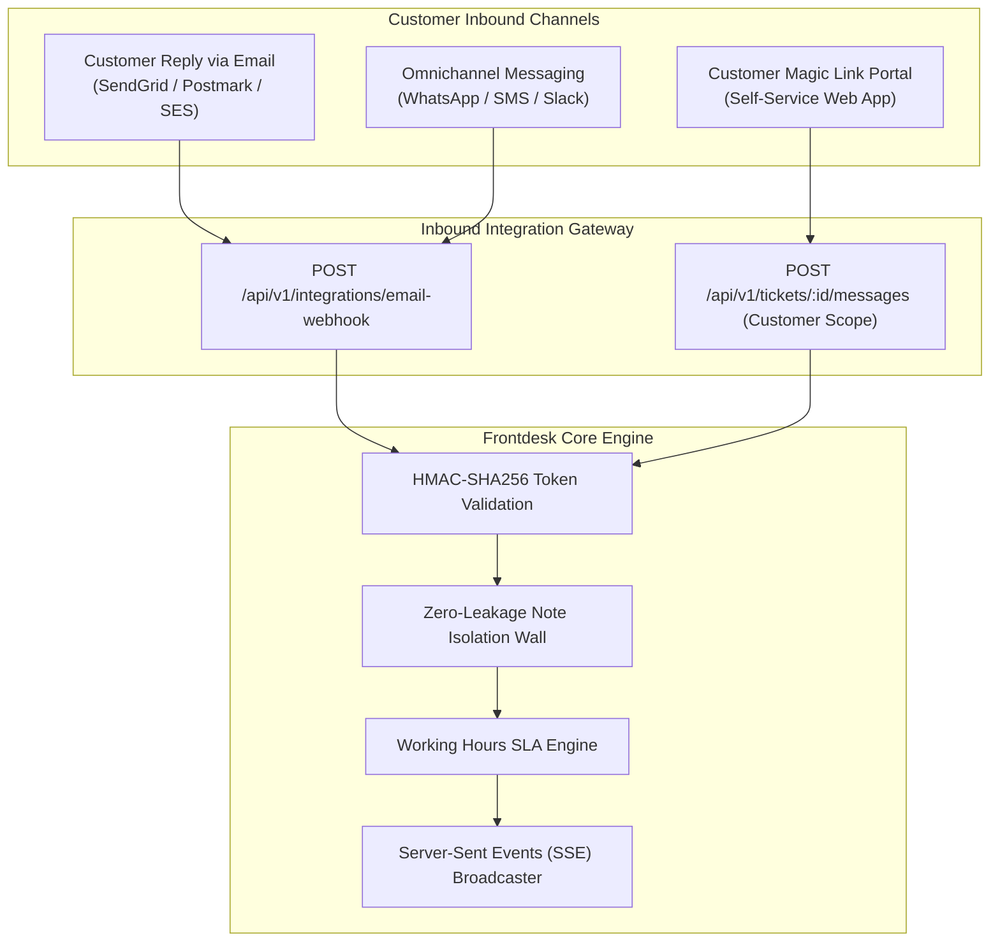

# Customer Communication & Real-World Integration Architecture

> **Document**: `CUSTOMER_INTEGRATION.md`  
> **Status**: Production Reference & Integration Blueprint  
> **Related Specifications**: `PROJECT_V3.md`, `DOC_V2.md`, Stage 4 Working Hours SLA (INC-0327)

---

## 1. Executive Summary & Purpose

In Frontdesk, ticket resolution is an asynchronous dialogue between **Support Agents** and **Customers**. 

When an agent needs additional logs, verification, or customer action, sending a public reply transitions the ticket into **`waiting_on_customer`** and **freezes the SLA clock**. In production, the ticket remains paused until the customer replies, at which point the SLA resumes and deadline extensions are applied dynamically.

This document details:
1. The **current core mechanics** (how customer replies operate and trigger SLA resumption).
2. The **developer simulator** (how reviewers test this flow today from the UI).
3. The **production integration roadmap** (how inbound email webhooks, customer magic links, and omnichannel gateways connect real customers directly into Frontdesk).

---

## 2. Current Architecture & Core Mechanics

### 2.1 The State Machine & SLA Clock Pausing

```
[ open / in_progress ]
        │
        │ Agent sends Public Reply
        ▼
[ waiting_on_customer ]  <── SLA Clock FROZEN (sla_paused_at = now)
        │
        ├── Customer Replies (Email / Portal / Webhook)
        │       │
        │       ▼
        │   [ in_progress ]  <── SLA Clock RESUMED & Extended by business duration waited
        │
        └── Customer remains inactive for 5 working days (45 business hours)
                │
                ▼
            [ closed ]  <── System Automator Auto-Close (REQ-SLA-04)
```

1. **State Transition & Clock Freeze (`REQ-SLA-03`)**:
   - When an agent submits a message with `sender_type="agent"` and `is_private=false`, the backend:
     - Sets `ticket.status = "waiting_on_customer"`.
     - Stamps `ticket.sla_paused_at = datetime.now(timezone.utc)`.
     - Records `PUBLIC_REPLY_SENT` audit trail event.
     - Pushes `PUBLIC_REPLY_SENT` via Server-Sent Events (SSE).

2. **Automatic Resumption on Customer Message**:
   - When an inbound message arrives with `sender_type="customer"`:
     - Sets `ticket.status = "in_progress"`.
     - Calculates elapsed business minutes: `paused_minutes = calculate_business_minutes_between(ticket.sla_paused_at, now)`.
     - Extends resolution deadline: `ticket.resolution_due_at = add_business_minutes(ticket.resolution_due_at, paused_minutes)`.
     - Clears `ticket.sla_paused_at = None` and increments `ticket.total_paused_minutes`.
     - Records `CUSTOMER_REPLY_RECEIVED` in the immutable audit log.
     - Emits `CUSTOMER_REPLY_RECEIVED` event downstream to all connected agent browsers.

3. **Inactivity Guard (`REQ-SLA-04`)**:
   - If no customer reply is received within **5 Indian working days (45 hours = 2,700 business minutes)**, the ticket automatically transitions to `closed` with system log: *"Auto-closed due to 1 week of customer inactivity."*

---

## 3. The Interactive Testing Simulator

To test and verify this full cycle without requiring external email infrastructure, the agent workspace provides an interactive simulation tool:

1. Open any ticket in the **Dashboard**.
2. Switch composer mode to **💬 Reply to Customer** and send a message.
3. The ticket enters **Waiting on Customer** and displays the green **Customer Reply Simulator Banner**.
4. Click **⚡ Simulate [Customer] Reply**.
5. Observe:
   - The ticket status immediately flips back to **In Progress**.
   - The SLA countdown clock unfreezes and recalculates.
   - The conversation timeline appends the customer message.
   - The audit trail records `CUSTOMER_REPLY_RECEIVED`.

---

## 4. Production Integration Roadmap for Real Customers

In an enterprise deployment, real customer messages enter Frontdesk via three standard production channels:



### Channel 1: Inbound Email Webhook Parsing (e.g. Postmark / SendGrid / AWS SES)

1. **Email Routing**:
   - Outbound agent emails set `Reply-To: support+INC-0291@help.arvo.in`.
   - When the customer replies in their email client (Gmail, Outlook, Apple Mail), the email provider's Inbound Parse Webhook forwards a JSON payload to our backend.
2. **Webhook Endpoint Specification**:
   ```http
   POST /api/v1/integrations/email-webhook
   X-Webhook-Signature: sha256=...
   Content-Type: application/json

   {
     "from": "rahul@acmecorp.com",
     "to": "support+INC-0291@help.arvo.in",
     "subject": "Re: [INC-0291] System Performance Degradation",
     "text_body": "Thanks Meera! We applied the patch and CPU load is back to 15%.",
     "html_body": "...",
     "stripped_text": "Thanks Meera! We applied the patch and CPU load is back to 15%."
   }
   ```
3. **Processing Logic**:
   - Extract ticket ID (`INC-0291`) from recipient address or email headers (`References` / `In-Reply-To`).
   - Match `from` address with `ticket.customer_email`.
   - Strip previous email thread quotes (`stripped_text`).
   - Dispatch to `messages.post_ticket_message` with `sender_type="customer"`.

---

### Channel 2: Self-Service Customer Web Portal (Passwordless Magic Links)

1. **HMAC Magic Link Generation**:
   - Each ticket generates a deterministic, tamper-proof customer token:
     $$\text{Token} = \text{HMAC-SHA256}(\text{SecretKey}, \text{ticket\_id} \parallel \text{customer\_email})$$
   - Outbound emails include a direct link:
     `https://support.arvo.in/portal/INC-0291?token=8a3f...`
2. **Customer Portal Capabilities**:
   - Customers authenticate passwordlessly via their token.
   - Strict note isolation wall: `GET /api/v1/tickets/{id}/messages?scope=customer` strips all private agent notes.
   - Customers type their reply directly in the web browser and submit with `sender_type="customer"`.

---

### Channel 3: Omnichannel Messaging (WhatsApp Business / Twilio SMS)

1. **Mobile Support**:
   - Customers receiving SMS or WhatsApp updates reply directly in their messaging app.
   - The WhatsApp Business Cloud API webhook forwards incoming messages to Frontdesk.
   - The phone number is verified against customer metadata, appending the message to the active ticket and waking the SLA timer.

---

## 5. Security & Isolation Safeguards

| Layer | Risk | Security Guarantee |
| :--- | :--- | :--- |
| **Note Isolation Wall** | Private team thoughts leaking to customer | Database query strictly enforces `is_private == False` whenever `scope="customer"`. Private notes are never returned in customer API responses. |
| **Token Tamper Proofing** | Malicious actor viewing another customer's ticket | Magic links use HMAC-SHA256 bound to both ticket ID and customer email. Changing the ticket ID or email invalidates the cryptographic signature. |
| **Audit Non-Repudiation** | Customer denies having replied or confirmed | Append-only audit trail logs `CUSTOMER_REPLY_RECEIVED` with timestamp and raw payload preview. Logs cannot be modified or deleted. |
| **Reopen Guard** | Reopening stale tickets months later | Customers can only reopen resolved/closed tickets within **7 calendar days** of resolution (`REQ-SLA-05`). Attempts after 7 days are rejected with HTTP 400. |

---

## 6. Summary

The **"Waiting on Customer"** state is a production-grade pattern that balances team accountability with operational fairness. While agents utilize the 1-click simulator during review and development, the underlying API contract (`POST /api/tickets/{id}/messages`) is completely decoupled and ready for drop-in email webhooks and customer portal integrations.
