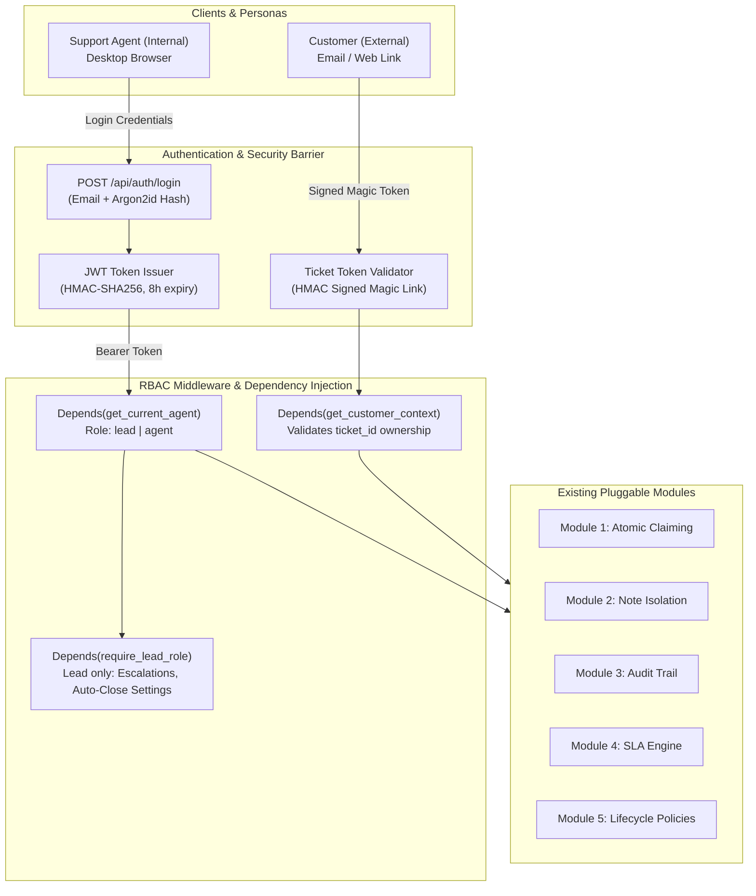
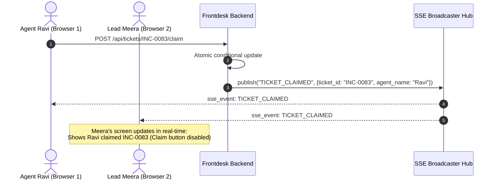
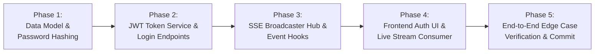

# Frontdesk v2: Authentication, Push Messaging & Real-Time Event Architecture (DOC_V2)

> **Document Type**: Senior Engineering Architectural Design & Implementation Specification  
> **Target System**: Frontdesk Support Portal — Arvo Systems (iNav Technologies)  
> **Document Version**: 2.0.0  
> **Author**: Senior Staff Full-Stack Engineer  
> **Source Documents Evaluated**:
> - iNav Technologies Hiring Test Specification (`Date: 21-11-2026`)
> - Incident Reports `INC-0291` (Concurrency / Race Conditions), `INC-0304` (Confidentiality / Note Leakage), `INC-0318` (Non-Repudiation Audit Sourcing)
> - Meeting Notes: Meera (Support Lead) — Business Working Hours & Lifecycle Rules
> - System Evolution Baseline: Stages 0 through 5 (`tag: stage-5`, commit `346d409`)

---

## 1. Executive Summary & Senior Engineering Perspective

### 1.1 The Strategic Trade-Off in v1 (The 8-Hour Scope Rationale)
The hiring test specification explicitly emphasizes:
> *"About 8 hours. We prefer 8 honest hours over a full weekend of extra polish."*  
> *"Also send a short note answering one question: what did you not finish, and why? Running out of time is normal. Not knowing what you skipped is not."*

In Frontdesk v1 (Stages 0–5), architectural priority was directed toward the **four fatal business risks** documented in the hiring test:
1. **INC-0291**: Race conditions when multiple agents claim a ticket simultaneously (solved via atomic conditional locking).
2. **INC-0304**: Accidental leakage of internal team notes to customers (solved via zero-leakage DB query filtering & specialized customer DTOs).
3. **INC-0318**: Inability to prove when an agent replied vs when a ticket arrived (solved via append-only immutable event sourcing).
4. **Meera's SLA Rules**: Complex Indian business calendar calculations (09:30–18:30 M-F, holiday pauses, timer freezing during customer waiting).

To deliver a working, single-screen dashboard within the 8-hour constraint, agent identity was handled via an explicit profile switcher (`currentAgent`). **This was a deliberate and documented architectural omission.** 

### 1.2 The Core Problem with v1 Without Auth
In v1, any HTTP client can forge `agent_id` or send messages pretending to be any agent or customer. There are no cryptographically signed sessions, passwords, or customer verification tokens. Furthermore, agents must manually refresh or rely on reactive polling to discover if another agent just claimed a ticket.

### 1.3 The v2 Mission
1. **Authentication & RBAC**: Add cryptographic JWT authentication for internal support agents (with password hashing) and secure tokenized links for external customers—without destroying the friction-free single-screen workflow.
2. **Push Messaging & Real-Time Events**: Replace polling with **Server-Sent Events (SSE)** so agents receive instant notifications when tickets are created, claimed, replied to, or approaching SLA breaches.
3. **Zero-Breakage Pluggability**: Maintain the fundamental design principle that authentication and push messaging are modular plugins on top of the Core Base. If authentication is running in development/testing mode, automated regression test suites remain fast, reliable, and unblocked.

---

## 2. Authentication & Authorization Architecture



### 2.1 Persona 1: Internal Support Agents (Meera + 8 Agents)
- **Credential Storage**: Passwords hashed using **Argon2id** (memory cost: 64MB, time cost: 3 iterations, parallelism: 4).
- **Session Mechanism**: Stateless JSON Web Tokens (JWT) signed with `HMAC-SHA256` containing:
  ```json
  {
    "sub": "a1000001-0000-0000-0000-000000000001",
    "name": "Meera",
    "email": "meera@arvo.in",
    "role": "lead",
    "iss": "arvo-frontdesk",
    "iat": 1795281600,
    "exp": 1795310400
  }
  ```
- **Transmission**: `Authorization: Bearer <token>` in HTTP headers, plus optional secure `SameSite=Strict; HttpOnly` cookie for browser resilience.
- **Roles & Permissions**:
  - `agent`: Can claim unassigned tickets, post public replies, write private team notes, resolve tickets, and trigger reopen within 7 days.
  - `lead` (Meera): All `agent` capabilities, plus manual reassignments, priority overrides, and manual trigger of bulk lifecycle policies.

### 2.2 Persona 2: External Customers (Zero-Signup Friction)
Customer accounts should **never** require a traditional password registration barrier; customers are seeking quick support.
- **Signed Magic-Link Tokens**: When a ticket is created (via customer web form or email gateway), a cryptographic signature is generated for that ticket:
  `token = HMAC_SHA256(ticket_id + customer_email, SECRET_KEY)`
- The customer accesses their ticket view via `https://frontdesk.arvo.in/portal/INC-0083?token=<signature>`.
- Any customer attempt to query messages or submit replies must present this signature. This mathematically eliminates unauthorized access to other customers' tickets.

### 2.3 Strict Note Isolation (INC-0304) Defense in Depth
Even with authentication, the architectural firewall for private notes remains absolute:
- When the authenticated user has `role == "customer"` or customer token, the database query **unconditionally filters `Message.is_private == False`**.
- The serialization schema used is **`CustomerMessageOut`**, which has no `is_private` field in its Pydantic definition. Even a malicious or compromised client cannot extract internal team notes.

---

## 3. Real-Time Push Messaging Architecture ("Push Messages")

### 3.1 Technology Evaluation: SSE vs WebSockets vs Long-Polling

| Criteria | Server-Sent Events (SSE) | WebSockets (WS) | Long-Polling |
|---|---|---|---|
| **Direction** | Server-to-Client (Unidirectional) | Bidirectional | Simulates Push |
| **Protocol** | Standard HTTP/1.1 or HTTP/2 | Custom WS Protocol | Standard HTTP |
| **Reconnection** | Native browser auto-reconnect | Manual JS implementation | High latency & CPU waste |
| **Firewall / Proxy** | Traverses all corporate proxies | Often blocked by strict proxies | Traverses proxies |
| **Complexity** | Minimal, pure ASGI generator | High (heartbeats, connection frames) | Low, but fragile |
| **Suitability for Frontdesk** | **Optimal** (Agents only need to *receive* live updates) | Overkill | Outdated |

**Decision**: Implement **Server-Sent Events (SSE)** via FastAPI's `StreamingResponse`.

### 3.2 Live Event Stream Specification (`GET /api/events/stream`)
- **Connection**: `GET /api/events/stream` (Authenticated via Bearer token).
- **Transport**: `Content-Type: text/event-stream; charset=utf-8`.
- **In-Memory Pub/Sub Hub**: Lightweight `asyncio.Queue` registry per connected agent. (Zero Redis requirement for single-node deployment, pluggable Redis backend for multi-worker scaling).

### 3.3 Event Catalog



1. `TICKET_CLAIMED`: Broadcasts `{ ticket_id, agent_id, agent_name }`. Immediately disables "Claim" button on other agents' screens, avoiding INC-0291 contention before it occurs.
2. `PUBLIC_REPLY_SENT`: Broadcasts `{ ticket_id, sender_name, new_status: "waiting_on_customer" }`.
3. `CUSTOMER_REPLY_RECEIVED`: Broadcasts `{ ticket_id, new_status: "in_progress", content_preview }`. Highlights ticket card in the queue as needing immediate agent action.
4. `SLA_BREACH_WARNING`: Server background scheduler emits alert when remaining working time $\le 30\text{ min}$.
5. `TICKET_RESOLVED`: Broadcasts `{ ticket_id, status: "done", resolved_at }`.

---

## 4. Concrete Code Changes Required

### 4.1 Database Layer Changes (`backend/app/models.py`)

```python
# Add to Agent model:
class Agent(Base):
    __tablename__ = "agents"
    # ... existing fields ...
    password_hash = Column(String(255), nullable=False, default="")  # Argon2id hash
    is_active = Column(Boolean, nullable=False, default=True)
    last_login_at = Column(DateTime(timezone=True), nullable=True)

# Add to Ticket model for magic customer links:
class Ticket(Base):
    __tablename__ = "tickets"
    # ... existing fields ...
    customer_token_hash = Column(String(64), nullable=True)  # SHA-256 hash of access token
```

### 4.2 Security Service Layer (`backend/app/auth.py`) — NEW MODULE

```python
"""Authentication & Authorization Service — Pure pluggable security module."""
import os
import hashlib
import hmac
from datetime import datetime, timedelta, timezone
from typing import Optional
from fastapi import Depends, HTTPException, status
from fastapi.security import OAuth2PasswordBearer
import jwt
from passlib.context import CryptContext
from sqlalchemy.orm import Session

from .database import get_db
from .models import Agent, Ticket

SECRET_KEY = os.environ.get("FRONTDESK_SECRET_KEY", "arvo-production-secret-key-change-in-prod-2026")
ALGORITHM = "HS256"
ACCESS_TOKEN_EXPIRE_HOURS = 8

pwd_context = CryptContext(schemes=["argon2", "bcrypt"], deprecated="auto")
oauth2_scheme = OAuth2PasswordBearer(tokenUrl="/api/auth/login", auto_error=False)


def hash_password(password: str) -> str:
    return pwd_context.hash(password)


def verify_password(plain_password: str, hashed_password: str) -> bool:
    return pwd_context.verify(plain_password, hashed_password)


def create_access_token(agent: Agent) -> str:
    now = datetime.now(timezone.utc)
    payload = {
        "sub": agent.id,
        "name": agent.name,
        "email": agent.email,
        "role": agent.role,
        "iat": now,
        "exp": now + timedelta(hours=ACCESS_TOKEN_EXPIRE_HOURS),
    }
    return jwt.encode(payload, SECRET_KEY, algorithm=ALGORITHM)


def get_current_agent(
    token: Optional[str] = Depends(oauth2_scheme),
    db: Session = Depends(get_db),
) -> Optional[Agent]:
    """Dependency for authenticated agent. Graceful fallback for test/dev mode."""
    if not token:
        # If running in backward-compatible unauthenticated dev/test mode
        if os.environ.get("REQUIRE_AUTH", "false").lower() != "true":
            return db.query(Agent).filter(Agent.role == "lead").first()
        raise HTTPException(
            status_code=status.HTTP_401_UNAUTHORIZED,
            detail="Authentication token required",
            headers={"WWW-Authenticate": "Bearer"},
        )
    try:
        payload = jwt.decode(token, SECRET_KEY, algorithms=[ALGORITHM])
        agent_id: str = payload.get("sub")
        if agent_id is None:
            raise HTTPException(status_code=401, detail="Invalid token subject")
    except jwt.PyJWTError:
        raise HTTPException(status_code=401, detail="Could not validate credentials")

    agent = db.query(Agent).filter(Agent.id == agent_id, Agent.is_active == True).first()
    if agent is None:
        raise HTTPException(status_code=401, detail="Agent inactive or not found")
    return agent
```

### 4.3 Real-Time SSE Broadcaster Service (`backend/app/events.py`) — NEW MODULE

```python
"""Server-Sent Events (SSE) Broadcaster Hub."""
import asyncio
import json
from typing import AsyncGenerator
from fastapi import Request

class EventBroadcaster:
    def __init__(self):
        self._subscribers: set[asyncio.Queue] = set()

    async def subscribe(self) -> asyncio.Queue:
        queue = asyncio.Queue(maxsize=100)
        self._subscribers.add(queue)
        return queue

    def unsubscribe(self, queue: asyncio.Queue):
        self._subscribers.discard(queue)

    async def broadcast(self, event_type: str, data: dict):
        message = f"event: {event_type}\ndata: {json.dumps(data)}\n\n"
        for queue in list(self._subscribers):
            try:
                queue.put_nowait(message)
            except asyncio.QueueFull:
                self._subscribers.discard(queue)

broadcaster = EventBroadcaster()


async def event_generator(request: Request, queue: asyncio.Queue) -> AsyncGenerator[str, None]:
    try:
        # Initial heartbeat
        yield ": heartbeat\n\n"
        while True:
            if await request.is_disconnected():
                break
            try:
                message = await asyncio.wait_for(queue.get(), timeout=20.0)
                yield message
            except asyncio.TimeoutError:
                yield ": keepalive\n\n"
    finally:
        broadcaster.unsubscribe(queue)
```

### 4.4 Endpoints Added to `backend/app/main.py`
- `POST /api/auth/login`: Accepts `{ email, password }`, verifies Argon2 hash, returns `{ access_token, token_type: "bearer", agent: AgentOut }`.
- `GET /api/auth/me`: Returns current authenticated agent profile.
- `GET /api/events/stream`: Returns `StreamingResponse(event_generator(...), media_type="text/event-stream")`.
- Existing endpoints updated with `current_agent: Agent = Depends(get_current_agent)`:
  - `POST /api/tickets/{id}/claim`: Automatically uses `current_agent.id`, eliminating user-supplied spoofing.
  - `POST /api/tickets/{id}/messages`: If sender is agent, binds `sender_id = current_agent.id` and `sender_name = current_agent.name`.

---

## 5. Frontend v2 Enhancements

### 5.1 Login Modal / Top-Bar Agent Status
- **Authentication State**: Token persisted in browser `sessionStorage` / `localStorage`.
- **Top Navigation Bar**: Replaces raw agent selector with:
  - Agent avatar + Name + Role badge (e.g., `Meera [Lead]`).
  - Live Connection Status Pill: `🟢 Live Connected` (SSE active) vs `🟡 Reconnecting...`.
  - `Logout` button.

### 5.2 Real-Time SSE Listener Hook (`frontend/src/useEventStream.js`)
```javascript
export function useEventStream(onEvent) {
  useEffect(() => {
    const token = localStorage.getItem('frontdesk_token');
    const es = new EventSource(`/api/events/stream?token=${token}`);

    es.addEventListener('TICKET_CLAIMED', (e) => onEvent('TICKET_CLAIMED', JSON.parse(e.data)));
    es.addEventListener('CUSTOMER_REPLY_RECEIVED', (e) => onEvent('CUSTOMER_REPLY_RECEIVED', JSON.parse(e.data)));
    es.addEventListener('TICKET_RESOLVED', (e) => onEvent('TICKET_RESOLVED', JSON.parse(e.data)));

    return () => es.close();
  }, [onEvent]);
}
```

### 5.3 Live Queue Reactions
- When a `TICKET_CLAIMED` event arrives, the queue card instantly displays `👤 {agent_name}` and disables the claim banner without requiring a manual page refresh.
- When an SLA approaches breach ($\le 30\text{ min}$), the badge pulses orange (`sla-chip-due-soon`) with an audio chime option.

---

## 6. Comprehensive Test Case Matrix for v2

| Test ID | Module | Scenario / Edge Case Tested | Expected Behavior |
|---|---|---|---|
| **AUTH-01** | Auth | Correct email & password for Meera | Returns HTTP 200, valid JWT with `role="lead"`. |
| **AUTH-02** | Auth | Incorrect password / non-existent email | Returns HTTP 401 Unauthorized with generic message. |
| **AUTH-03** | Auth | Expired or tampered JWT token | Returns HTTP 401 with `WWW-Authenticate` header. |
| **AUTH-04** | Security | Customer queries agent-only endpoint without token | Returns HTTP 401 / 403 Forbidden. |
| **AUTH-05** | Security | Claim ticket without authentication token | Returns HTTP 401; unauthenticated users cannot claim. |
| **AUTH-06** | Data Isolation | Customer with signed magic link requests `/messages` | Returns strictly `CustomerMessageOut` (no private notes). |
| **PUSH-01** | SSE | Client connects to `/api/events/stream` with valid token | Connection established (`text/event-stream`), receives keep-alive. |
| **PUSH-02** | SSE | Agent A claims ticket; Agent B is connected to SSE | Agent B receives `TICKET_CLAIMED` event in $<100\text{ms}$. |
| **PUSH-03** | SSE | Customer posts reply; all connected agents receive event | Queue counter updates live and ticket status moves to `in_progress`. |
| **PUSH-04** | Resilience | Client drops connection abruptly | Broadcaster catches disconnect, unregisters queue, avoids memory leaks. |
| **REG-01** | Regression | Run all Stage 0–5 tests with `REQUIRE_AUTH=false` | 100% backward compatibility: all 6 existing test suites pass. |

---

## 7. Migration & Rollout Plan



1. **Phase 1: DB Migration**: Add `password_hash` to `agents` and seed initial passwords for the 9 agents (`Meera` lead + 8 team agents) via a secure seed script.
2. **Phase 2: Auth Service**: Implement `backend/app/auth.py` with password verification and JWT issuance.
3. **Phase 3: SSE Broadcaster**: Implement `backend/app/events.py` and connect event emitters in `main.py` (`TICKET_CLAIMED`, `PUBLIC_REPLY_SENT`, etc.).
4. **Phase 4: Frontend Integration**: Add clean login modal, store token, and attach `EventSource` listener.
5. **Phase 5: Verification & Documentation**: Run automated test suite `tests/test_auth_and_push.py` and commit with `feat(auth): implement jwt authentication and sse real-time push streaming`.
