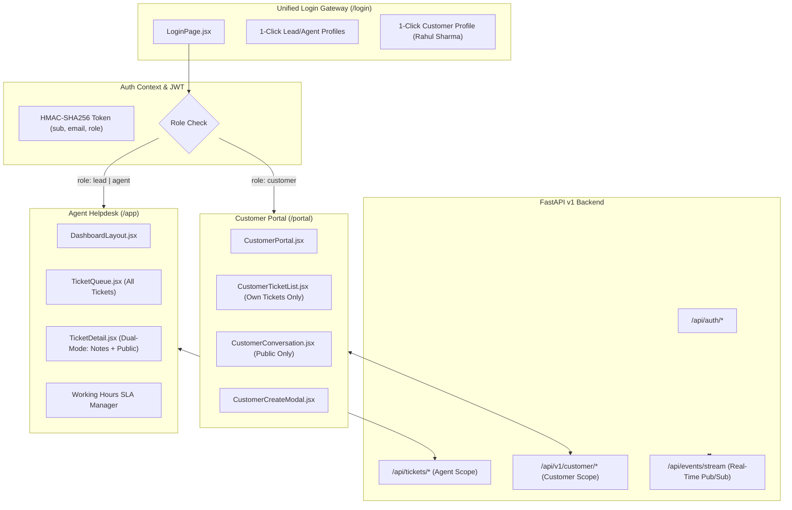

# FRONTDESK V5 SPECIFICATION — REAL CUSTOMER PORTAL & END-TO-END WORKFLOW

> **Document**: `DOC_V5.md`  
> **Status**: Approved for Implementation  
> **Target Version**: Frontdesk v5.0.0  
> **Repository**: `git@github.com:Firoz-zaman/frontdesk.git` (`main`)

---

## 1. Executive Summary & Purpose

In Frontdesk v4, customer responses were simulated using a testing button in the agent workspace. In **Frontdesk v5**, we eliminate simulation entirely in favor of a **first-class Customer Portal**:

1. **Remove Simulator**: All simulation controls and banners in the agent workspace are completely removed.
2. **First-Class Customer Persona**: A dedicated database model and authenticated customer account are introduced with Argon2id password hashing and JWT sessions.
3. **Dedicated Customer Portal UI**: Customers log into their own self-service portal to view only their tickets, submit new tickets, and send real replies.
4. **End-to-End SLA Cycle**:
   - Support Agent sends a Public Reply $\rightarrow$ Ticket enters `waiting_on_customer` (SLA timer freezes).
   - Real Customer logs in to their Customer Portal $\rightarrow$ Reads the agent reply $\rightarrow$ Types and sends a response.
   - Backend automatically transitions ticket back to `in_progress` $\rightarrow$ Unfreezes and extends SLA clock $\rightarrow$ Pushes real-time SSE updates to both agent and customer.
5. **Zero-Leakage Wall**: Customer APIs and portal views strictly isolate all internal agent notes (`is_private == True`).

---

## 2. Customer Credentials

| Field | Production Value |
| :--- | :--- |
| **Persona** | Verified Corporate Customer |
| **Name** | **Rahul Sharma** |
| **Company** | **Acme Corporation** |
| **Email** | **`customer@acmecorp.com`** |
| **Password** | **`arvo2026!`** |
| **Role** | `customer` |

*Note: For testing convenience, a 1-click Quick Login chip for Rahul Sharma will be provided on the login page alongside the demo agent chips.*

---

## 3. System Architecture & Persona Separation



---

## 4. API Specification for Customer Portal

### 4.1 Authentication
- `POST /api/auth/login`:
  - Accepts `{ email, password }`.
  - Authenticates either an Agent or a Customer.
  - Returns:
    ```json
    {
      "access_token": "ey...",
      "token_type": "bearer",
      "user_type": "customer",
      "user": {
        "id": "c1000001-0000-0000-0000-000000000001",
        "name": "Rahul Sharma",
        "email": "customer@acmecorp.com",
        "company": "Acme Corporation",
        "role": "customer"
      }
    }
    ```
- `GET /api/auth/me`: Returns profile of current user (Agent or Customer).

### 4.2 Customer Ticket Operations (`/api/v1/customer`)
- `GET /api/v1/customer/tickets`:
  - Strictly filtered: `WHERE customer_email == current_customer.email`.
  - Returns ticket summaries with SLA status, agent name, and timestamps.
- `POST /api/v1/customer/tickets`:
  - Allows customer to file a new ticket directly.
  - Defaults: `customer_name = current_customer.name`, `customer_email = current_customer.email`.
  - Calculates initial working hours SLA deadlines based on priority.
- `GET /api/v1/customer/tickets/{id}/messages`:
  - **Zero-Leakage Wall**: Strictly executes `WHERE is_private == False`.
  - Prevents leaking internal team notes to customer.
- `POST /api/v1/customer/tickets/{id}/messages`:
  - Posts customer message (`sender_type = "customer"`).
  - Automatically unfreezes SLA and switches ticket to `in_progress` if currently `waiting_on_customer`.
  - Emits `CUSTOMER_REPLY_RECEIVED` SSE event to connected agents.

---

## 5. Phased Implementation Strategy

Following standard senior engineering discipline, implementation will proceed in four distinct, verified phases:

### Phase 1: Customer Data Model, Seeding & Authentication
- Add `Customer` ORM table in `backend/app/models.py`.
- Add customer schemas (`CustomerOut`, `CustomerLoginRequest`) in `schemas.py`.
- Seed `customer@acmecorp.com` (`arvo2026!`) with initial tickets in `seed.py`.
- Update `backend/app/api/v1/auth.py` and `dependencies.py` to authenticate customers and agents.
- **Commit**: `feat(auth): customer account model, seeding, and unified jwt authentication` $\rightarrow$ Push.

### Phase 2: Dedicated Customer API Router
- Create `backend/app/api/v1/customer.py` with endpoints for listing own tickets, viewing conversation, submitting replies, and creating tickets.
- Enforce cryptographic zero-leakage wall.
- Mount router under `/api/v1/customer`.
- Backend unit & integration tests.
- **Commit**: `feat(api): customer portal endpoints with zero-leakage wall and sla auto-resumption` $\rightarrow$ Push.

### Phase 3: Frontend Customer Portal & UI Integration
- Remove simulation banner and button from `frontend/src/components/tickets/TicketDetail.jsx`.
- Clean up simulation CSS in `frontend/src/index.css`.
- Build `CustomerPortal.jsx` and subcomponents (`CustomerTicketList.jsx`, `CustomerTicketDetail.jsx`, `CustomerNewTicketModal.jsx`).
- Update `LoginPage.jsx` to include Customer quick profile and tab.
- Update `App.jsx` to dynamically render `CustomerPortal` when logged in as customer.
- Frontend production build verification (`npm run build`).
- **Commit**: `feat(frontend): customer portal interface and remove simulation controls` $\rightarrow$ Push.

### Phase 4: End-to-End Multi-Persona Verification
- Author comprehensive E2E test suite `test_v5_customer_e2e.py` verifying:
  1. Customer login with `customer@acmecorp.com` / `arvo2026!`.
  2. Agent sends public message $\rightarrow$ ticket flips to `waiting_on_customer` (SLA pauses).
  3. Customer logs in $\rightarrow$ cannot see private agent notes.
  4. Customer replies $\rightarrow$ ticket flips to `in_progress` (SLA unfreezes).
  5. Cross-customer ticket isolation (Customer A cannot access Customer B's tickets).
- Run all test suites (100% pass guarantee).
- **Commit**: `test(e2e): multi-persona customer portal verification and regression suite` $\rightarrow$ Push.
