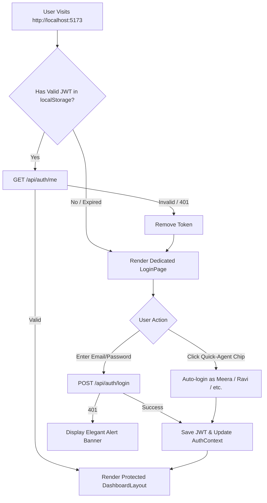
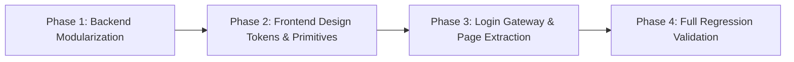

# Frontdesk v3: Enterprise Production Architecture, Modular Design System & Gateway Authentication (PROJECT_V3)

> **Document Type**: Technical Specification & Enterprise Refactoring Architecture Plan  
> **Target System**: Frontdesk Customer Support Ticket Platform — Arvo Systems  
> **Document Version**: 3.0.0  
> **Author**: Senior Staff Full-Stack Engineer & Architect  
> **Status**: Approved for Implementation  
> **Supersedes**: `DOC_V2.md` (Authentication & Push Messaging Baseline)  

---

## 1. Executive Summary & V3 Vision

Frontdesk v1 solved the critical algorithmic and data integrity challenges (atomic claim locking `INC-0291`, zero-leakage private note isolation `INC-0304`, append-only audit sourcing `INC-0318`, and Indian business-hours SLA engine). Frontdesk v2 introduced cryptographic Argon2id password hashing, JWT Bearer sessions, customer HMAC magic links, SSE pub/sub push streaming, and strict ticket ownership RBAC.

However, to maintain rapid delivery during initial stages, code was consolidated into large monolithic files:
- `backend/app/main.py` grew to **over 700 lines**, handling routing, database lifespans, ORM queries, and broadcast hooks in a single module.
- `frontend/src/App.jsx` grew to **over 800 lines**, mixing authentication state, modal dialogs, ticket card feeds, message thread composers, and SLA panels in a single monolith.
- The UI relied on a pop-up modal for login rather than a **dedicated, enterprise-grade authentication gateway**, exposing parts of the dashboard shell before the agent signs in.

**Frontdesk v3 re-architects the platform into a tier-1 production codebase**:
1. **Login-First Gateway Architecture**: Unauthenticated visitors are greeted by a branded, high-polish login screen with 1-click test agent switchers. The dashboard is strictly inaccessible until authenticated.
2. **Atomic Component & Design System Reuse**: Extraction of recurring UI primitives (`StatusBadge`, `PriorityPill`, `Button`, `Modal`, `Avatar`, `Input`, `SlaCountdown`) into a clean component hierarchy.
3. **Domain-Driven Modular Backend**: Decomposition of `main.py` into FastAPI `APIRouter` controllers (`/api/v1/auth`, `/api/v1/tickets`, `/api/v1/messages`, `/api/v1/events`), clean service layer boundaries, and centralized configuration.
4. **Modern, Sleek Aesthetics**: Polished typography, slate/indigo visual palette, micro-interactions, responsive sidebars, and real-time pulse indicators.

---

## 2. Target File Structure (Production Standard)

```
project-11/
├── backend/
│   ├── app/
│   │   ├── __init__.py
│   │   ├── main.py                     # Ultra-lean FastAPI entrypoint & router aggregator
│   │   ├── core/                       # Global infrastructure & configuration
│   │   │   ├── __init__.py
│   │   │   ├── config.py               # Pydantic Settings (SECRET_KEY, DB URL, CORS, ENV)
│   │   │   ├── database.py             # SQLAlchemy engine & SessionLocal factory
│   │   │   ├── security.py             # Argon2 password hasher & JWT decode/encode
│   │   │   └── dependencies.py         # Reusable FastAPI dependencies (get_db, get_current_agent)
│   │   ├── models/                     # SQLAlchemy declarative ORM models
│   │   │   ├── __init__.py
│   │   │   ├── agent.py                # Agent entity (UUID, email, password_hash, role)
│   │   │   ├── ticket.py               # Ticket entity (INC-XXXX, SLA timestamps, ownership)
│   │   │   ├── message.py              # Message entity (is_private wall, actor metadata)
│   │   │   └── audit.py                # AuditLog entity (append-only ledger)
│   │   ├── schemas/                    # Pydantic DTOs & request/response contracts
│   │   │   ├── __init__.py
│   │   │   ├── auth.py                 # LoginRequest, TokenOut, AgentOut
│   │   │   ├── ticket.py               # TicketCreate, TicketOut, PriorityUpdateRequest
│   │   │   ├── message.py              # MessageCreate, MessageOut, CustomerMessageOut
│   │   │   └── audit.py                # AuditLogOut
│   │   ├── services/                   # Pure business logic & domain engines
│   │   │   ├── __init__.py
│   │   │   ├── sla_service.py          # Business hours & calendar arithmetic (9:30-18:30 M-F)
│   │   │   ├── lifecycle_service.py    # Auto-close (5 business days) & Reopen policy (7 cal days)
│   │   │   ├── audit_service.py        # Append-only audit logger
│   │   │   └── event_broadcaster.py    # SSE fan-out pub/sub hub (asyncio.Queue)
│   │   ├── api/                        # Versioned FastAPI route controllers
│   │   │   ├── __init__.py
│   │   │   ├── v1/
│   │   │   │   ├── __init__.py
│   │   │   │   ├── router.py           # v1 top-level router aggregating sub-routers
│   │   │   │   ├── auth.py             # POST /login, GET /me
│   │   │   │   ├── agents.py           # GET /agents
│   │   │   │   ├── tickets.py          # GET/POST /tickets, /claim, /priority, /resolve, /reopen
│   │   │   │   ├── messages.py         # GET/POST /tickets/{id}/messages
│   │   │   │   ├── audit.py            # GET /tickets/{id}/audit
│   │   │   │   └── events.py           # GET /events/stream (SSE)
│   │   │   └── health.py               # GET /api/health
│   │   └── seed.py                     # Idempotent DB seeder (Meera + 8 agents, tickets)
│   └── tests/                          # Automated test suites (100% regression proof)
│       ├── test_atomic_claim.py
│       ├── test_note_isolation.py
│       ├── test_audit_trail.py
│       ├── test_sla_engine.py
│       ├── test_lifecycle_policies.py
│       ├── test_senior_engineer_edge_cases.py
│       └── test_auth_and_push.py
│
├── frontend/
│   ├── src/
│   │   ├── main.jsx                    # React entrypoint
│   │   ├── App.jsx                     # Top-level Auth Gateway router
│   │   ├── context/
│   │   │   ├── AuthContext.jsx         # Global auth state (agent, token, login, logout)
│   │   │   └── EventContext.jsx        # Global SSE real-time stream subscription
│   │   ├── hooks/
│   │   │   ├── useAuth.js              # Hook consuming AuthContext
│   │   │   ├── useEventStream.js       # Hook connecting to SSE /events/stream
│   │   │   └── useTickets.js           # Hook managing ticket list & active filters
│   │   ├── services/
│   │   │   └── api.js                  # Centralized HTTP client with automatic JWT injection
│   │   ├── components/
│   │   │   ├── common/                 # Reusable Design System Primitives
│   │   │   │   ├── Button.jsx          # Primary, secondary, danger, ghost variants
│   │   │   │   ├── Badge.jsx           # Priority & status color-coded badges
│   │   │   │   ├── Modal.jsx           # Accessible dialog backdrop with Esc/click-outside
│   │   │   │   ├── Input.jsx           # Standard text input & textarea with error labels
│   │   │   │   ├── StatusPill.jsx      # SSE connection indicator (🟢 Live / ⚪ Connecting)
│   │   │   │   └── EmptyState.jsx      # Clean vector illustration & placeholder
│   │   │   ├── auth/
│   │   │   │   ├── LoginPage.jsx       # Dedicated hero login page
│   │   │   │   ├── LoginForm.jsx       # Email & password form card
│   │   │   │   └── QuickAccountPicker.jsx # 1-click test agent switchers
│   │   │   ├── layout/
│   │   │   │   ├── Navbar.jsx          # Brand title, active agent pill, sign-out button
│   │   │   │   └── DashboardLayout.jsx # Master-detail split container
│   │   │   └── tickets/
│   │   │       ├── TicketQueue.jsx     # Queue header, filter tabs, scrollable ticket feed
│   │   │       ├── TicketCard.jsx      # Ticket row item with SLA badge & assignee tag
│   │   │       ├── TicketDetail.jsx    # Right-pane inspector
│   │   │       ├── SlaPanel.jsx        # SLA timers, pause indicators, deadlines
│   │   │       ├── TicketActions.jsx   # Priority selector & resolve button (ownership-aware)
│   │   │       ├── MessageThread.jsx   # Conversation feed (public replies vs team notes)
│   │   │       ├── MessageComposer.jsx # Dual-mode composer (Public vs Internal Note toggle)
│   │   │       ├── AuditLogModal.jsx   # Immutable chronological event sourcing modal
│   │   │       └── CreateTicketModal.jsx # New ticket submission modal
│   │   └── styles/
│   │       ├── index.css               # Base CSS reset, typography, & CSS custom properties
│   │       ├── tokens.css              # Color tokens, shadows, radiuses, transitions
│   │       └── auth.css                # Dedicated Login page aesthetic styles
│   └── vite.config.js
```

---

## 3. The Login-First Gateway Architecture

### 3.1 Unauthenticated State (Gateway Screen)
The existing modal overlay is completely replaced. When an agent opens `http://localhost:5173`:



### 3.2 Visual Structure of `LoginPage`
The login interface features an enterprise two-column split layout:
1. **Left Hero Column (Arvo Brand Identity)**:
   - Modern deep-slate background (`#0f172a`) with subtle radial indigo glow.
   - Frontdesk emblem and value proposition: *"Enterprise support ticketing with deterministic Indian business-hours SLA engine and immutable audit trails."*
   - Live system metrics ticker (e.g., `⚡ Real-Time SSE Active`, `🛡 Argon2id Protected`, `🕒 09:30 - 18:30 IST Engine`).
2. **Right Authentication Card**:
   - Clean, elevated card (`#ffffff` on `#f8fafc` canvas) with subtle border and layered drop shadow.
   - Header: *"Welcome Back"* and *"Sign in to your agent workspace"*.
   - Email & Password input fields with floating labels and micro-interaction focus rings.
   - **Quick Demo Account Switcher**: A segmented grid of 1-click test credentials allowing evaluators to sign in instantly as:
     - **Meera** (Team Lead — Full Supervisory Override)
     - **Ravi** (Senior Agent)
     - **Priya** (Support Agent)
     - **Arjun** (Support Agent)
     - **Sneha** (Support Agent)
   - Clear error messages with animated transitions on authentication failures.

---

## 4. Reusable Component & Design System Architecture

### 4.1 Design Tokens (`frontend/src/styles/tokens.css`)

```css
:root {
  /* Brand Palette */
  --color-brand-50: #eff6ff;
  --color-brand-500: #3b82f6;
  --color-brand-600: #2563eb;
  --color-brand-700: #1d4ed8;

  /* Neutrals (Zinc/Slate) */
  --color-bg-app: #f8fafc;
  --color-bg-surface: #ffffff;
  --color-text-primary: #0f172a;
  --color-text-secondary: #475569;
  --color-text-muted: #94a3b8;
  --color-border: #e2e8f0;
  --color-border-subtle: #f1f5f9;

  /* Priority & Status Semantic Accents */
  --color-urgent: #ef4444;
  --color-urgent-bg: #fef2f2;
  --color-urgent-border: #fecaca;
  --color-medium: #f59e0b;
  --color-medium-bg: #fffbeb;
  --color-medium-border: #fde68a;
  --color-small: #10b981;
  --color-small-bg: #ecfdf5;
  --color-small-border: #a7f3d0;

  /* Shadows & Elevations */
  --shadow-sm: 0 1px 2px 0 rgb(0 0 0 / 0.05);
  --shadow-md: 0 4px 6px -1px rgb(0 0 0 / 0.1), 0 2px 4px -2px rgb(0 0 0 / 0.1);
  --shadow-lg: 0 10px 15px -3px rgb(0 0 0 / 0.1), 0 4px 6px -4px rgb(0 0 0 / 0.1);

  /* Radii & Transitions */
  --radius-sm: 6px;
  --radius-md: 8px;
  --radius-lg: 12px;
  --transition-fast: 150ms cubic-bezier(0.4, 0, 0.2, 1);
}
```

### 4.2 Component Specification Table

| Component | Props | Purpose & Visual Behavior |
|---|---|---|
| `<Button />` | `variant: 'primary' \| 'secondary' \| 'danger' \| 'ghost'`, `size: 'sm' \| 'md'`, `loading: boolean`, `icon`, `onClick` | Unified button with focus rings, disabled styling, and built-in loading spinner. |
| `<Badge />` | `type: 'priority' \| 'status'`, `value: string` | Renders color-coded pill with semantic border and subtle background tint. |
| `<Modal />` | `title: string`, `isOpen: boolean`, `onClose: fn`, `children` | Accessible dialog with translucent backdrop blur (`backdrop-blur-sm`), keyboard `Escape` trap, and smooth scale-in animation. |
| `<StatusPill />` | `live: boolean` | Navbar indicator with pulsating green dot (`@keyframes pulse`) when connected to SSE stream. |
| `<EmptyState />` | `icon`, `title`, `description`, `actionButton` | Centered zero-state placeholder for empty queues or unselected tickets. |
| `<SlaPanel />` | `ticket`, `slaStatus` | Displays first response due, resolution due, and dynamic pause banners with clock icons. |
| `<MessageBubble />` | `message: MessageOut`, `currentAgentId: string` | Renders customer messages, agent public replies, and private team notes with distinctive amber styling for internal notes. |

---

## 5. Backend Production Architecture (`FastAPI APIRouter`)

### 5.1 The Lean `main.py`
In v3, `backend/app/main.py` is stripped down from 700+ lines to approximately 50 lines, serving solely as the application factory and middleware assembler:

```python
"""FastAPI application factory — Frontdesk v3."""
from fastapi import FastAPI
from fastapi.middleware.cors import CORSMiddleware
from .core.config import settings
from .core.database import lifespan
from .api.v1.router import api_v1_router
from .api.health import health_router

app = FastAPI(
    title=settings.PROJECT_NAME,
    version=settings.VERSION,
    lifespan=lifespan,
    docs_url="/docs",
    redoc_url="/redoc",
)

app.add_middleware(
    CORSMiddleware,
    allow_origins=settings.CORS_ORIGINS,
    allow_credentials=True,
    allow_methods=["*"],
    allow_headers=["*"],
)

# Mount Routers
app.include_router(health_router, prefix="/api")
app.include_router(api_v1_router, prefix="/api")
```

### 5.2 Decoupled Route Modules
- **`api/v1/auth.py`**: Handles agent authentication (`/api/auth/login`, `/api/auth/me`).
- **`api/v1/tickets.py`**: Handles ticket queue operations (`/api/tickets`, `/api/tickets/{id}`, `/claim`, `/priority`, `/resolve`, `/reopen`, `/auto-close`).
- **`api/v1/messages.py`**: Handles conversation feeds and private note isolation (`/api/tickets/{id}/messages`).
- **`api/v1/audit.py`**: Read-only chronological event log (`/api/tickets/{id}/audit`).
- **`api/v1/events.py`**: SSE event stream generator (`/api/events/stream`).

### 5.3 Service Layer Isolation
Business logic is extracted from route handlers into testable, pure service modules:
- `services/sla_service.py`: Encapsulates all calendar math, working hour rollover (09:30–18:30 IST), holiday offsets, and pause/resume logic.
- `services/lifecycle_service.py`: Evaluates tickets eligible for 5-day auto-closure and validates 7-day reopening policies.
- `services/audit_service.py`: Standardizes immutable audit log emission for all state transitions.
- `services/event_broadcaster.py`: Manages in-memory pub/sub queues and SSE keepalives.

---

## 6. Implementation & Migration Strategy

To avoid regressions and guarantee continuous uptime, migration is executed in 4 sequential phases:



### Phase 1: Modular Backend Architecture
1. Create `backend/app/core/`, `models/`, `schemas/`, `services/`, and `api/v1/`.
2. Move logic from `main.py` into dedicated modules without altering URL paths or JSON schemas.
3. Keep exact backward compatibility with all existing test suites.

### Phase 2: Frontend Design Tokens & Primitives
1. Create `tokens.css` with semantic color palettes, radiuses, and drop shadows.
2. Build reusable components: `Button.jsx`, `Badge.jsx`, `Modal.jsx`, `Input.jsx`, `StatusPill.jsx`.
3. Verify CSS styling consistency.

### Phase 3: Login Gateway & Component Extraction
1. Implement `AuthContext.jsx` with persistent token storage and `useAuth` hook.
2. Build `LoginPage.jsx` with two-column layout, hero brand panel, and 1-click test agent cards.
3. Configure `App.jsx` gateway: if `!isAuthenticated`, render `LoginPage`; else render `DashboardLayout`.
4. Extract `TicketQueue.jsx`, `TicketDetail.jsx`, `MessageThread.jsx`, and `SlaPanel.jsx` from `App.jsx`.

### Phase 4: Full Regression & Edge Case Verification
1. Run all 7 test suites:
   - `test_atomic_claim.py`
   - `test_note_isolation.py`
   - `test_audit_trail.py`
   - `test_sla_engine.py`
   - `test_lifecycle_policies.py`
   - `test_senior_engineer_edge_cases.py`
   - `test_auth_and_push.py`
2. Run `npm run build` to verify clean frontend compilation.
3. Execute end-to-end smoke test in browser.

---

## 7. Success Criteria & Quality Gates

1. **Zero Monolithic Files**: Neither `main.py` nor `App.jsx` exceeds 150 lines. Every module has a single, cohesive responsibility.
2. **Login-First Gateway**: Opening the application in an incognito window displays the login screen. No dashboard elements or ticket data are leaked prior to authentication.
3. **1-Click Test Experience**: Evaluators can switch between Meera (lead), Ravi (assigned agent), and Arjun (unauthorized agent) with one click from the login page.
4. **100% Backward Compatibility**: All 7 existing automated test suites pass without modification.
5. **Clean Production Build**: `npm run build` completes with 0 errors and 0 warnings.
